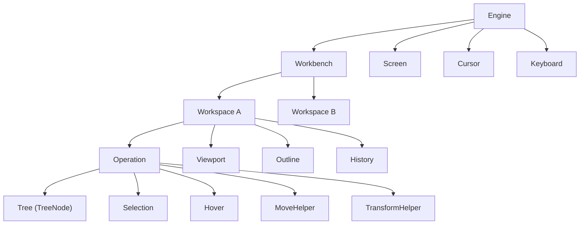

# 架构与对象模型

::: tip 本章正在编写
站点骨架与「快速开始」已经可用，本章会随后补全。下面是计划覆盖的内容。
:::

## 本章将覆盖

- `Engine → Workbench → Workspace → Operation` 的持有关系与职责边界。
- `Operation` 下的 `Tree`、`Selection`、`Hover`、`MoveHelper`、`TransformHelper` 分别解决什么问题。
- `viewport`、`outline`、`screen` 三个视口概念的区别。
- 一次拖拽从 driver 到 tree mutation、snapshot、history 的数据流。

## 先读这些

- [快速开始](./getting-started)
- 源码：`packages/core/src/models/`、`packages/core/src/drivers/`

## 延伸阅读（转载）

- [designable 工程结构](./source-reading/01-project-structure)：目录结构、各包职责与工程配置。
- [Designable 源码阅读系列](./source-reading/)：陈豪（xjchenhao）的 8 篇源码阅读文章。
