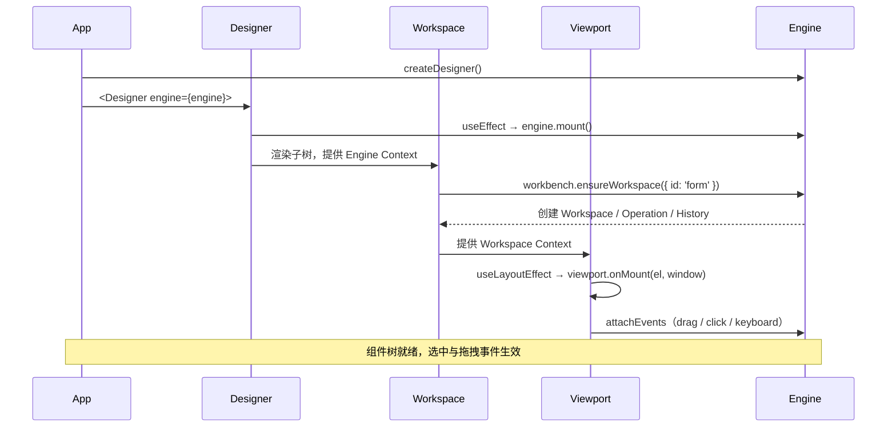

# 快速开始

这一章只做一件事：**从零渲染一个可以选中、可以拖拽的设计器画布**，并解释这段代码里每一层在做什么。读完你应该能判断自己的项目该从哪一层接入。

## 前置条件

| 依赖        | 要求        | 说明                                                                                         |
| ----------- | ----------- | -------------------------------------------------------------------------------------------- |
| React       | 16.x / 17.x | `@designable/react` 的 peer dependency                                                       |
| antd        | 4.x         | `@designable/react`、`@designable/formily-antd` 的 peer dependency                           |
| @formily/\* | 2.x         | `reactive`、`reactive-react`、`core`、`react` 等                                             |
| 构建工具    | 支持 Less   | 包内直接 `import './styles.less'`，webpack 需配置 `less-loader`（`javascriptEnabled: true`） |

::: tip 在仓库内运行
本仓库的 playground 已经配好 TypeScript、Less、workspace alias。想先看完整效果，直接在仓库根目录执行：

```bash
nvm use 16
yarn install
yarn workspace @designable/formily-antd start
```

:::

## 版本与安装路径 {#versions}

本手册基于仓库 `main`（commit `3e961de`）的源码。**npm 上最新的 `@designable/core` 是 `1.0.0-beta.45`，比该提交早 34 个提交**，`core`、`react`、`formily-*` 都有差异。因此有两条安装路径：

### 路径 A：在本仓库内开发（推荐）

仓库使用 Yarn workspaces，playground 的 webpack 配置会把 `@designable/*` alias 到各包的 `src`。你不需要先构建各包：

```bash
nvm use 16
yarn install
yarn workspace @designable/formily-antd start   # http://localhost:3000
```

适合：基于本 fork 定制设计器、需要改核心代码、对照源码阅读。

### 路径 B：外部项目安装 npm 包

```bash
yarn add @designable/core @designable/react @designable/formily-antd
# 按需补充 Formily / antd 的 peer dependencies
```

适合：只想消费已发布版本。注意 beta.45 与本文档的差异；遇到文中存在但包里没有的 API，以仓库源码和 `examples/` 为准。

## 最小画布

下面这个例子只依赖 `@designable/core` 和 `@designable/react`，目标是让你看清「引擎 → 工作区 → 画布 → 组件树」这条最小链路。

```tsx
// src/App.tsx
import React from 'react'
import ReactDOM from 'react-dom'
import {
  ComponentTreeWidget,
  Designer,
  Viewport,
  Workspace,
} from '@designable/react'
import {
  createBehavior,
  createDesigner,
  GlobalRegistry,
} from '@designable/core'

// 1. 根节点要声明为可放置容器，否则无法接收拖入的节点
GlobalRegistry.setDesignerBehaviors([
  createBehavior({
    name: 'Root',
    selector: 'Root',
    designerProps: {
      droppable: true,
    },
  }),
])

// 2. 设计器认识哪些组件
const components = {
  Root: (props: any) => (
    <div style={{ minHeight: 320, padding: 16 }}>{props.children}</div>
  ),
  Input: (props: any) => <input {...props} />,
}

// 3. 创建引擎，并给一个初始组件树
const engine = createDesigner({
  rootComponentName: 'Root',
  defaultComponentTree: {
    children: [
      {
        componentName: 'Input',
        props: { placeholder: '点击选中我' },
      },
    ],
  },
})

export default function App() {
  return (
    <Designer engine={engine}>
      <Workspace id="form">
        <Viewport>
          <ComponentTreeWidget components={components} />
        </Viewport>
      </Workspace>
    </Designer>
  )
}

ReactDOM.render(<App />, document.getElementById('root'))
```

这段代码只提供画布和选中能力，**没有物料面板，所以还不能从面板拖入新组件**。物料的注册方式见[注册系统与物料](./registry-and-materials)。

## 刚才发生了什么

四层容器的职责和挂载顺序如下：



对应源码：

- `createDesigner()`：`packages/core/src/externals.ts`，在 `new Engine(...)` 上补默认 drivers / effects / shortcuts。
- `<Designer>`：`packages/react/src/containers/Designer.tsx`，在 `useEffect` 里 `engine.mount()`，卸载时 `engine.unmount()`。
- `<Workspace>`：`packages/react/src/containers/Workspace.tsx`，渲染期调用 `designer.workbench.ensureWorkspace(...)`；核心对象在 `packages/core/src/models/Workbench.ts` 与 `Workspace.ts` 创建。
- `<Viewport>`：`packages/react/src/containers/Viewport.tsx`，在 `useLayoutEffect` 里调用核心 `Viewport.onMount(element, contentWindow)`，并负责 iframe 场景。
- `ComponentTreeWidget`：`packages/react/src/widgets/ComponentTreeWidget/index.tsx`，把 `TreeNode` 渲染成真实 React 组件，并通过 `registerDesignerBehaviors(props.components)` 收集组件上的 `Behavior`。

更完整的对象关系见[架构与对象模型](./architecture)，挂载/销毁细节见[生命周期](./lifecycle)。

## 加上面板：接近 playground 的骨架

最小画布只够理解链路。真实设计器通常由「物料面板 + 大纲树 + 画布 + 设置面板」组成。下面是 `formily/antd/playground/main.tsx` 的骨架（省略业务按钮与保存逻辑）：

```tsx
import React from 'react'
import {
  CompositePanel,
  ComponentTreeWidget,
  Designer,
  DesignerToolsWidget,
  HistoryWidget,
  OutlineTreeWidget,
  ResourceWidget,
  SettingsPanel,
  StudioPanel,
  ToolbarPanel,
  ViewPanel,
  ViewToolsWidget,
  Workspace,
  WorkspacePanel,
  ViewportPanel,
} from '@designable/react'
import { SettingsForm } from '@designable/react-settings-form'
import { Card, Field, Form, Input, Select } from '@designable/formily-antd'
import { createDesigner } from '@designable/core'

const engine = createDesigner({
  rootComponentName: 'Form',
})

export default function App() {
  return (
    <Designer engine={engine}>
      <StudioPanel>
        <CompositePanel>
          <CompositePanel.Item title="panels.Component" icon="Component">
            <ResourceWidget title="sources.Inputs" sources={[Input, Select]} />
            <ResourceWidget title="sources.Layouts" sources={[Card]} />
          </CompositePanel.Item>
          <CompositePanel.Item title="panels.OutlinedTree" icon="Outline">
            <OutlineTreeWidget />
          </CompositePanel.Item>
          <CompositePanel.Item title="panels.History" icon="History">
            <HistoryWidget />
          </CompositePanel.Item>
        </CompositePanel>

        <Workspace id="form">
          <WorkspacePanel>
            <ToolbarPanel>
              <DesignerToolsWidget />
              <ViewToolsWidget use={['DESIGNABLE', 'JSONTREE']} />
            </ToolbarPanel>
            <ViewportPanel>
              <ViewPanel type="DESIGNABLE">
                {() => (
                  <ComponentTreeWidget
                    components={{ Form, Field, Input, Select, Card }}
                  />
                )}
              </ViewPanel>
              <ViewPanel type="JSONTREE">
                {(tree) => (
                  <pre>{JSON.stringify(tree.serialize(), null, 2)}</pre>
                )}
              </ViewPanel>
            </ViewportPanel>
          </WorkspacePanel>
        </Workspace>

        <SettingsPanel title="panels.PropertySettings">
          <SettingsForm />
        </SettingsPanel>
      </StudioPanel>
    </Designer>
  )
}
```

和最小画布相比，多了三件事：

1. **物料来自组件本身**：`@designable/formily-antd` 导出的 `Input`、`Select` 等组件带有静态 `Behavior` 与 `Resource`，`ResourceWidget` 与 `ComponentTreeWidget` 会直接消费。
2. **`WorkspacePanel` / `ViewportPanel` / `ViewPanel`** 负责视图切换（设计态、JSON 树、预览等）。
3. **`SettingsPanel` + `SettingsForm`** 根据选中节点的 `designerProps.propsSchema` 生成属性表单。

## 运行与验证

- 仓库内：`yarn workspace @designable/formily-antd start`，打开 playground，确认左侧物料可拖入画布、点击节点右侧出现属性面板、`Ctrl/Cmd + Z` 可撤销。
- 外部项目：确认构建工具已处理 `.less`；如果画布空白，先检查 `rootComponentName` 是否与 `components` 里的根组件名一致，以及根节点的 behavior 是否 `droppable: true`。
- 常见问题见[故障排查](./appendix/troubleshooting)。

## 下一步

- 想理解对象之间的关系：读[架构与对象模型](./architecture)。
- 想搞清楚 mount / unmount 与快照时机：读[生命周期](./lifecycle)。
- 想接入自己的业务组件：读[注册系统与物料](./registry-and-materials)。
- 想把设计结果存成 Formily Schema 并渲染：读[Formily 集成](./formily-integration)。
- 想了解工程结构和二次开发：读[源码阅读系列（转载）](./source-reading/)。
