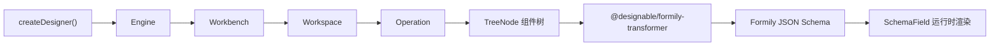

## 这本手册解决什么问题

仓库里的各包 README 基本只有标题，源码注释也很少。直接读实现来接入，容易被 `Engine`、`Workbench`、`Workspace`、`Operation` 这一串对象绕住。

这本手册只覆盖一条主线：**用 `@designable/core` + `@designable/react` + `@designable/formily-antd` 搭出表单设计器，并把 Schema 接回 Formily**。每个结论都对照当前仓库源码，示例来自 `examples/` 和 `formily/antd/playground`。

## 主线数据流

完整的对象图（`Selection`、`History`、`Viewport`、`Outline` 等旁支）见[架构与对象模型](./architecture)。

## 包与职责

| 包                                | 职责                                                                   | 手册位置                                                                                        |
| --------------------------------- | ---------------------------------------------------------------------- | ----------------------------------------------------------------------------------------------- |
| `@designable/core`                | 引擎、工作区、节点树、事件、注册表、撤销重做                           | [架构与对象模型](./architecture)、[TreeNode](./tree-node)、[注册系统](./registry-and-materials) |
| `@designable/react`               | Designer 容器、面板、Widgets、Hooks                                    | [React 层](./react-layer)                                                                       |
| `@designable/formily-antd`        | Ant Design 物料、Behavior、Resource、设置面板 Schema                   | [Formily 集成](./formily-integration)                                                           |
| `@designable/formily-transformer` | TreeNode 与 Formily JSON Schema 的双向转换                             | [Formily 集成](./formily-integration)                                                           |
| `@designable/formily-setters`     | `DataSourceSetter`、`ReactionsSetter`、`ValidatorSetter` 等配套 setter | [Formily 集成](./formily-integration)                                                           |
| `@designable/react-settings-form` | 设置面板表单与通用 setter                                              | [React 层](./react-layer)                                                                       |

## 从哪里开始

[**第一次接入** 装依赖、渲染画布、理解最小闭环。](./getting-started)

[**理解对象模型** Engine → Workbench → Workspace → Operation 到底谁管谁。](./architecture)

[**搞清生命周期** 什么时候 mount、什么时候绑定事件、什么时候销毁。](./lifecycle)

[**接入 Formily** TreeNode 与 JSON Schema 互转，保存、预览、运行时渲染。](./formily-integration)

## 源码阅读系列（转载）

陈豪（xjchenhao）的 8 篇 Designable 源码阅读文章已按作者声明转载，涵盖工程结构、运行与二开、全局注册、自定义组件、响应器等主题。每篇均保留作者、原文链接与发布时间。

[进入源码阅读系列](./source-reading/)

## 版本基准

本手册基于本仓库 `main`（commit `3e961de`）的源码整理。npm 上最新的 `@designable/core` 是 `1.0.0-beta.45`，比该提交早 34 个提交；外部项目安装 npm 包时，遇到与文中不一致的 API，请以仓库源码为准。详见[快速开始](./getting-started#versions)。

